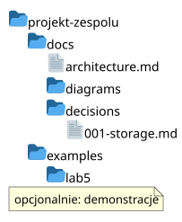
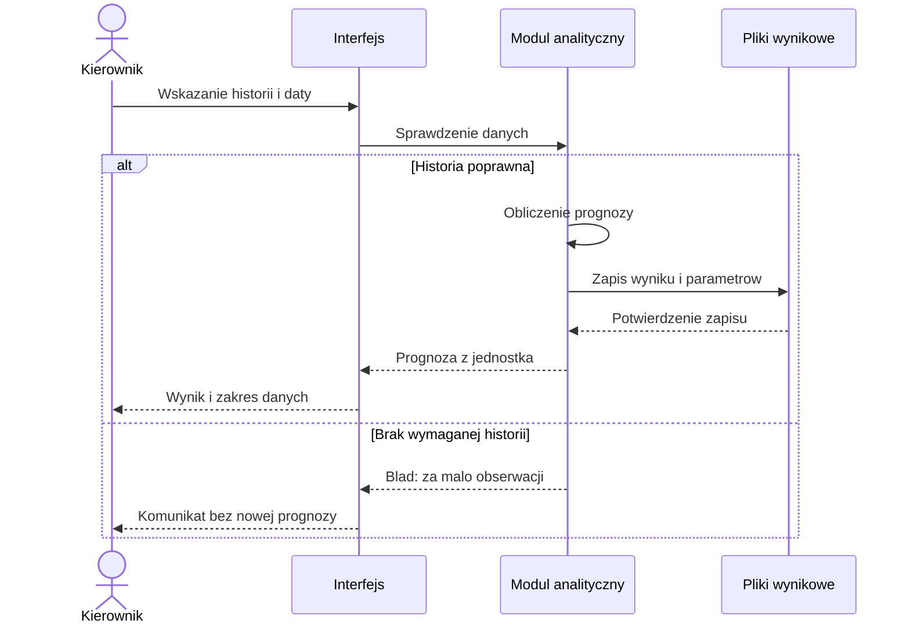
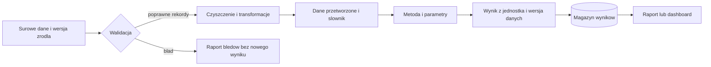
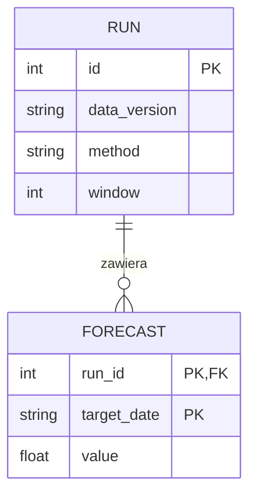

# Laboratorium 5: Projektowanie obiektów informatycznych

**Specjalność: Systemy informatyczne w zarządzaniu**

## Cel zajęć

Na tych zajęciach należy zaprojektować aplikację, bazę danych lub moduł analityczny na podstawie wymagań, przygotowanych danych i wyników porównania metod. Rezultatem ma być opis wystarczający do podziału implementacji: granice rozwiązania, przebieg jednej ważnej operacji, struktura danych i uzasadnienie wyboru technologii.

Nie należy projektować systemu od początku, jeżeli część już działa. Trzeba wykorzystać kod i wyniki z Lab 3–4, wskazać potrzebne zmiany oraz odróżnić elementy istniejące od planowanych.

## Przygotowanie przed zajęciami

Należy otworzyć `docs/problem.md`, słownik danych, `docs/processing.md` i `docs/experiment.md`. Trzeba wybrać jedno wymaganie dotyczące decyzji użytkownika oraz przygotować dostęp do edytora diagramów. Nie trzeba zakładać nowego repozytorium ani instalować wszystkich opisanych narzędzi.

## Rezultat pracy



| Ścieżka | Zawartość |
|---|---|
| `docs/architecture.md` | Przypadek użycia, odpowiedzialności, interfejsy i model danych |
| `docs/diagrams/` | Edytowalne diagramy i eksport PNG/SVG, jeśli potrzebny |
| `docs/decisions/`, np. `001-storage.md` | Jedna istotna decyzja i rozważana alternatywa; nazwa pliku odpowiada tematowi decyzji |
| `examples/lab5/` | Wyłącznie demonstracje, jeśli wykonywane |

Diagramy Mermaid można umieścić bezpośrednio w `docs/architecture.md`. Dla diagramów graficznych należy zachować plik źródłowy, np. `.drawio`, oraz czytelny eksport. Sam obraz nie wystarcza do wygodnej aktualizacji projektu.

## Dobór architektury do projektu

Należy wybrać wariant odpowiadający wymaganiom. Tabela przedstawia możliwości, nie cztery obowiązkowe implementacje. Można łączyć warianty, jeśli zespół potrafi uzasadnić każdą dodatkową granicę systemu.

| Wariant | Główny przepływ | Granice i diagramy | Co trzeba rozstrzygnąć? |
|---|---|---|---|
| Moduł analityczny / CLI wsadowe | pliki → walidacja → obliczenie → raport lub JSON | sekwencja operacji, przepływ danych, schemat plików | wersjonowanie wejścia, parametry i ochrona poprzednich wyników |
| Aplikacja z relacyjną bazą | interfejs → logika i zapytania SQL → SQLite/PostgreSQL | sekwencja, ERD, granica transakcji | klucze, spójność zapisu, równoczesny dostęp |
| Usługa z API | żądanie HTTP → walidacja → logika → magazyn lub odpowiedź | sekwencja, kontrakt endpointu, model danych | kody błędów, dostęp, ponowienie żądania i limity |
| Dashboard analityczny / BI | zasilanie → agregacja → widoki i filtry | przepływ danych, model analityczny, sekwencja odświeżenia | częstotliwość odświeżania, definicje miar i dostępność danych |

DataGrip służy do pracy nad bazą, zapytaniami i diagnostyką; nie jest warstwą pośrednią, przez którą aplikacja musi wysyłać zapytania. Aplikacja łączy się z bazą przez odpowiedni sterownik lub bibliotekę.

## Przebieg zajęć — 90 minut

### 1. Wybór operacji i podział pracy — 0–10 min

Należy wybrać jeden główny przypadek użycia i nadać mu identyfikator, np. UC-01. **Przypadek użycia** opisuje cel użytkownika i reakcję systemu, a nie listę ekranów. Trzeba powiązać go z wymaganiem z Lab 2.

Pracę należy podzielić na opis operacji i interfejsów, diagram zachowania, model danych oraz decyzję i przegląd spójności. Każda osoba powinna przygotować sprawdzalny rezultat; przy wspólnym pliku Markdown trzeba uzgodnić kolejność edycji.

### 2. Granice systemu i opis przypadku użycia — 10–25 min

W `docs/architecture.md` należy wskazać użytkownika, systemy zewnętrzne i zakres odpowiedzialności własnego rozwiązania. Następnie trzeba opisać operację według przykładu:

| Element | Przykład: UC-01 — przygotowanie prognozy zgłoszeń |
|---|---|
| Cel i wymaganie | Kierownik potrzebuje prognozy na następny dzień do planowania obsady |
| Wejście | Plik dziennych liczebności, data prognozy, wybrana metoda |
| Warunek rozpoczęcia | Dostępna historia kończąca się przed dniem prognozy |
| Przebieg | Wczytanie → kontrola danych → obliczenie → zapis wyniku → wyświetlenie |
| Wynik | Prognoza z jednostką, datą, nazwą metody i zakresem danych |
| Brak danych | Przerwanie obliczeń i komunikat wskazujący brakujący okres; bez pozornej prognozy „0” |
| Kryterium odbioru | Dla znanej próbki wynik zgodny z ręcznym obliczeniem; błędny plik nie tworzy nowego wyniku |

Dla własnego projektu należy zastąpić wszystkie przykłady. Nie należy dodawać logowania, panelu administracyjnego ani bazy danych, jeżeli wymagania ich nie uzasadniają.

### 3. Diagram sekwencji i kontrakt między modułami — 25–45 min

Należy przygotować diagram sekwencji UML dla wybranego przypadku, z co najmniej jedną ścieżką błędną. **Diagram sekwencji** pokazuje kolejność komunikatów pomiędzy uczestnikami operacji. Trzeba odróżnić użytkownika, interfejs, przetwarzanie i zapis; nie muszą to być osobne serwery.

Do diagramu należy dopisać kontrakt jednej granicy między modułami: nazwy i typy wejść, jednostki, wynik i sposób sygnalizowania błędu. Przykład: `forecast(history: list[float], window: int) -> float`, wejście w zgłoszeniach na dzień, wynik na następny dzień, `ValueError` przy zbyt krótkiej historii. Nie należy przekazywać informacji o błędzie jako liczby 0, jeśli 0 jest poprawną prognozą.

Należy również zaznaczyć przepływ danych według wzoru poniżej. Można umieścić go obok diagramu sekwencji w tym samym pliku. Kontrakt trzeba dobrać do rzeczywistej granicy: funkcji, API albo zapisu w bazie — nie trzeba przygotowywać wszystkich trzech.

### 4. Model danych i decyzja architektoniczna — 45–70 min

Należy przygotować model logiczny: jakie obiekty lub zbiory istnieją, co oznacza pojedynczy rekord i jak są powiązane. Następnie trzeba wskazać model fizyczny, czyli konkretny zapis: tabele z typami i kluczami albo pliki z formatem, ścieżką i schematem pól.

Dla projektu z bazą należy przygotować ERD. Dla analizy plikowej można przygotować schemat wejścia i wyniku wraz z identyfikatorem uruchomienia oraz powiązaniem z wersją danych. Nie należy tworzyć fikcyjnej bazy wyłącznie na potrzeby diagramu.

Trzeba zapisać jedną decyzję architektoniczną z alternatywą według wzoru poniżej. Kolejne decyzje można uzupełnić w pracy własnej.

### 5. Przegląd projektu — 70–90 min

Inna osoba powinna prześledzić UC-01 od wejścia do wyniku, korzystając tylko z dokumentacji. Należy sprawdzić zgodność nazw pól z Lab 3, metody z Lab 4 i elementów diagramu z planowaną implementacją. Trzeba wskazać właściciela każdej potrzebnej zmiany w zgłoszeniu GitHub Issue (zawierającym krótki cel, kryterium odbioru i przypisaną osobę odpowiedzialną — zob. [przewodnik po narzędziach](../narzedzia/#github-issue-branch-i-pull-request)) oraz poprawić znalezioną niespójność.

## Przydatne narzędzia

| Narzędzie | Kiedy wykorzystać? | Rezultat |
|---|---|---|
| Mermaid | diagram w Markdownie, zmiany przeglądane razem z kodem | tekst diagramu i podgląd |
| diagrams.net | ręczne rozmieszczenie elementów, UML i schematy | plik `.drawio` i eksport |
| DataGrip | kontrola rzeczywistych tabel, kluczy i relacji | DDL i diagram zgodny z bazą |
| Markdown i GitHub Issues | opis kontraktów, decyzji i zadań implementacyjnych | dokumentacja powiązana z wymaganiem |

### Przygotowanie diagramu sekwencji UML (Mermaid)

Pod podglądem należy rozwinąć sekcję **Kod diagramu do skopiowania**, skopiować jej zawartość od wiersza `sequenceDiagram` i wkleić do pola kodu w [Mermaid Live Editor](https://mermaid.live/), zastępując domyślny przykład. Kod można zapisać jako `examples/lab5/sequence.mmd`. We własnym pliku Markdown należy umieścić go w bloku kodu oznaczonym jako `mermaid`.



<details markdown="1">
<summary>Kod diagramu do skopiowania</summary>

```text
sequenceDiagram
    actor K as Kierownik
    participant I as Interfejs
    participant A as Modul analityczny
    participant P as Pliki wynikowe
    K->>I: Wskazanie historii i daty
    I->>A: Sprawdzenie danych
    alt Historia poprawna
        A->>A: Obliczenie prognozy
        A->>P: Zapis wyniku i parametrow
        P-->>A: Potwierdzenie zapisu
        A-->>I: Prognoza z jednostka
        I-->>K: Wynik i zakres danych
    else Brak wymaganej historii
        A-->>I: Blad: za malo obserwacji
        I-->>K: Komunikat bez nowej prognozy
    end
```

</details>

Strzałki oznaczają komunikaty, a `alt/else` rozdziela warunki. Nie należy interpretować odstępów między strzałkami jako pomiaru czasu. **Ćwiczenie:** należy dopisać reakcję na błąd zapisu pliku; system nie powinien potwierdzić utrwalenia wyniku, którego nie zapisano. Składnię można sprawdzić w [dokumentacji diagramów sekwencji](https://mermaid.js.org/syntax/sequenceDiagram.html).

Jeżeli strona nie renderuje Mermaid, należy otworzyć kod w edytorze i wyeksportować obraz. Nie należy zakładać, że każda strona GitHub Pages obsługuje diagramy tak samo jak podgląd pliku na GitHubie.

### Przygotowanie schematu przepływu danych (Mermaid)

Poniższy schemat pokazuje, jakie dane powstają na kolejnych etapach. Nie jest formalnym diagramem DFD ani diagramem sekwencji UML. Pod podglądem należy rozwinąć sekcję **Kod diagramu do skopiowania**, skopiować tekst od wiersza `flowchart LR` do pola kodu w Mermaid Live Editor, a następnie zastąpić elementy nazwami ze swojego projektu.



<details markdown="1">
<summary>Kod diagramu do skopiowania</summary>

```text
flowchart LR
    R[Surowe dane i wersja zrodla] --> V{Walidacja}
    V -->|poprawne rekordy| T[Czyszczenie i transformacje]
    V -->|blad| E[Raport bledow bez nowego wyniku]
    T --> D[Dane przetworzone i slownik]
    D --> A[Metoda i parametry]
    A --> W[Wynik z jednostka i wersja danych]
    W --> M[(Magazyn wynikow)]
    M --> P[Raport lub dashboard]
```

</details>

**Ćwiczenie:** należy opisać format danych przy co najmniej dwóch strzałkach i wskazać, skąd odbiorca pozna datę ostatniego odświeżenia. Dla projektu bez magazynu można połączyć wynik bezpośrednio z raportem, wyjaśniając konsekwencje braku historii.

### Określenie kontraktu API lub operacji zapisu w bazie

Poniższy kontrakt API opisuje wyłącznie moduł obliczający średnią z ostatnich `window` obserwacji, bez trwałego zapisu. Jest to część UC-01, a nie cała operacja przygotowania i zapisania prognozy. Należy dostosować kontrakt do implementacji i zapisać go w `docs/architecture.md`.

Moduł wywołujący API odpowiada za odczyt pliku, sprawdzenie ciągłości dni i uporządkowanie historii chronologicznie. Musi również sprawdzić, że ostatnia obserwacja dotyczy dnia poprzedzającego datę prognozy, oraz wybrać ten moduł dla metody `moving_average`. Po otrzymaniu odpowiedzi łączy wynik z datą prognozy, nazwą metody, zakresem i wersją danych, a następnie przekazuje go do zapisu i wyświetlenia. Samo API przyjmujące listę liczb nie może sprawdzić dat ani brakujących dni. W projekcie należy wskazać moduł odpowiedzialny za te czynności na diagramie i w opisie UC-01.

| Element | Przykład |
|---|---|
| Operacja | `POST /api/forecast`, `Content-Type: application/json` |
| Wejście | `{"history":[12,14,13,15],"window":3}`; lista nieujemnych, skończonych liczb i dodatnie całkowite okno |
| Sukces | HTTP `200`, `{"forecast":14.0,"unit":"zgloszenia/dzien","window":3}` |
| Błędna składnia | HTTP `400`, `{"error":"invalid_json"}` dla niepoprawnego JSON |
| Niepoprawne dane | HTTP `422`, `{"error":"invalid_history"}` dla historii krótszej niż okno |
| Efekt uboczny | Brak zapisu; ponowienie tego samego żądania nie tworzy kolejnych rekordów |

To przyjęty podział błędów, nie zachowanie gwarantowane przez każdy framework. Należy sprawdzić implementację i testy; dla operacji tworzącej zasób trzeba dodatkowo określić identyfikator, kod sukcesu i regułę obsługi ponowień.

Dla bazy z poniższego DDL kontrakt zapisu może wyglądać następująco:

| Element | Ustalenie |
|---|---|
| Wejście | wersja danych, metoda, okno > 0, data ISO i skończona prognoza ≥ 0 |
| Operacja | utworzenie `run`, następnie `forecast` z otrzymanym identyfikatorem |
| Transakcja | oba zapisy zatwierdzone razem; błąd drugiego wycofuje pierwszy |
| Wynik | identyfikator uruchomienia i możliwość odczytu prognozy |
| Ograniczenia | FK do `run`, unikalna para `run_id, target_date`; w aplikacji kontrola daty, dodatniego całkowitego okna oraz typu, skończoności i nieujemności prognozy |

Nie należy traktować samego DDL jako pełnego kontraktu: nie opisuje on np. reakcji aplikacji na blokadę bazy. W `docs/architecture.md` trzeba wskazać, czy przy takim błędzie operacja kończy się komunikatem, czy jest bezpiecznie ponawiana.

### Przygotowanie diagramu ERD i definicji tabel SQL (Mermaid / DataGrip)

W projekcie przechowującym wiele prognoz można zastosować następujący model. **PK** oznacza klucz główny identyfikujący rekord, a **FK** — klucz obcy wskazujący rekord innej tabeli. Aby edytować przykład, należy rozwinąć sekcję **Kod diagramu do skopiowania** i wkleić jej zawartość od wiersza `erDiagram` do pola kodu w Mermaid Live Editor.



<details markdown="1">
<summary>Kod diagramu do skopiowania</summary>

```text
erDiagram
    RUN ||--o{ FORECAST : zawiera
    RUN {
        int id PK
        string data_version
        string method
        int window
    }
    FORECAST {
        int run_id PK, FK
        string target_date PK
        float value
    }
```

</details>

Należy odczytać relację: jedno uruchomienie może mieć zero lub wiele prognoz, a każda prognoza należy do jednego uruchomienia. Parę `run_id, target_date` przyjęto jako złożony klucz prognozy; drugi wynik dla tego samego dnia wymaga osobnego uruchomienia. Zasady notacji opisano w [dokumentacji ERD](https://mermaid.js.org/syntax/entityRelationshipDiagram.html).

Dla ścieżki bazodanowej należy otworzyć w DataGrip osobną demonstracyjną bazę SQLite i wykonać poniższy kod z pliku `examples/lab5/schema.sql`. Kod zakłada nową bazę bez tych tabel.

```sql
PRAGMA foreign_keys = ON;
CREATE TABLE run (
    id INTEGER PRIMARY KEY,
    data_version TEXT NOT NULL,
    method TEXT NOT NULL,
    window INTEGER NOT NULL CHECK (window > 0)
);
CREATE TABLE forecast (
    run_id INTEGER NOT NULL REFERENCES run(id),
    target_date TEXT NOT NULL,
    value REAL NOT NULL CHECK (value >= 0),
    PRIMARY KEY (run_id, target_date)
);
INSERT INTO run VALUES (1, 'demo-v1', 'moving_average', 3);
INSERT INTO forecast VALUES (1, '2026-10-09', 14.0);
SELECT r.method, f.target_date, f.value
FROM run AS r JOIN forecast AS f ON f.run_id = r.id;
```

Oczekiwany wynik to `moving_average | 2026-10-09 | 14.0`. Należy odświeżyć strukturę bazy, zaznaczyć tabele i wybrać **Diagrams → Show Diagram**. Trzeba porównać klucze i połączenie z ERD; diagram rzeczywistej bazy powinien wynikać z klucza obcego, nie tylko z podobnych nazw kolumn. Sposób generowania i eksportu PNG opisano w [dokumentacji DataGrip](https://www.jetbrains.com/help/datagrip/creating-diagrams.html).

**Ćwiczenie:** w tej samej sesji z włączonym `foreign_keys` należy spróbować wstawić prognozę dla `run_id = 999`, następnie duplikat pary `1, '2026-10-09'`. Obie operacje powinny zostać odrzucone. Trzeba wskazać, które ograniczenie chroni dane. Typ `TEXT` nie sprawdza poprawności daty kalendarzowej — tę kontrolę należy zaprojektować osobno.

Warunek `CHECK (value >= 0)` nie gwarantuje skończoności liczby: dodatnia nieskończoność spełnia to porównanie. Przed rozpoczęciem zapisu aplikacja powinna sprawdzić typ liczbowy, skończoność (np. `math.isfinite(value)` w Pythonie) i nieujemność wyniku oraz odrzucić `NaN` i nieskończoności. Należy również sprawdzić, czy okno jest dodatnią liczbą całkowitą; deklaracja `INTEGER` w tej tabeli SQLite nie zastępuje walidacji typu. Dla błędnej daty lub wartości operacja powinna zakończyć się komunikatem bez utworzenia rekordów `run` i `forecast`.

Dla analizy bez bazy należy zamiast DDL opisać np. `run.json` z wersją danych i parametrami oraz `forecast.csv` z datą, wartością i jednostką. Trzeba wyjaśnić, jak unikać nadpisania wyników różnych uruchomień.

### Przedstawienie granic systemu i modułów (diagrams.net)

1. Otworzyć [app.diagrams.net](https://app.diagrams.net/), wybrać zapis lokalny i pusty diagram.
2. Umieścić użytkownika poza prostokątem oznaczającym własny system; wewnątrz dodać główne moduły.
3. Połączyć elementy i opisać strzałki nazwami przekazywanych danych, np. „historia CSV”, nie samym „API”.
4. Zapisać edytowalny plik w `docs/diagrams/` oraz wyeksportować PNG lub SVG przez menu **File → Export as**.
5. Otworzyć eksport niezależnie od edytora i sprawdzić czytelność podpisów.

Wynikiem jest schemat granic systemu i jego modułów. Diagram kontekstowy przedstawiałby własny system jako jeden element wraz z użytkownikami i systemami zewnętrznymi, bez rozrysowywania modułów wewnętrznych. Żaden z tych widoków nie zastępuje diagramu sekwencji pokazującego kolejność działań. Nie należy przesyłać danych prywatnych do internetowego edytora; wystarczą nazwy i syntetyczne przykłady.

### Zapisanie decyzji architektonicznej ADR (Markdown)

**ADR** to krótki zapis decyzji architektonicznej: problemu, wyboru, alternatyw i konsekwencji. Należy zapisać go w `docs/decisions/`, dobierając nazwę do tematu, np. `001-storage.md` dla przechowywania wyników albo `001-api.md` dla wydzielenia usługi. Nazwa na diagramie katalogów jest przykładowa. Dla decyzji o zapisie wyników można wykorzystać strukturę:

```markdown
# ADR-001: Zapis wyników analizy
Status: przyjęta
Kontekst: jeden użytkownik uruchamia analizę lokalnie; brak równoczesnych zapisów.
Decyzja: osobny katalog każdego uruchomienia, CSV wyników i JSON parametrów.
Alternatywa: SQLite, ułatwiający filtrowanie historii i kontrolę relacji.
Powód wyboru: obecny zakres nie wymaga współbieżności ani zapytań po historii.
Konsekwencja: aplikacja musi sama pilnować zgodności schematu i unikalności uruchomień.
Warunek ponownego rozważenia: potrzeba wspólnej historii wielu użytkowników.
```

Należy uzupełnić decyzję kosztami, sposobem utrzymania i możliwościami zespołu tam, gdzie wpływają na wybór. „Znamy to narzędzie” może być argumentem, ale nie zastępuje sprawdzenia wymagań.

Temat ADR należy wybrać spośród rzeczywistych dylematów, np.:

| Decyzja | Alternatywy | Pytanie rozstrzygające |
|---|---|---|
| Przechowywanie | pliki / baza SQL | Czy potrzebne są relacje, wspólna historia lub równoczesny zapis? |
| Moment obliczeń | na żądanie / wstępna agregacja | Jak świeży musi być wynik i jak długo użytkownik może czekać? |
| Implementacja metody | biblioteka / własny algorytm | Czy biblioteka realizuje wymagania, ma odpowiednią licencję i daje się zweryfikować? |
| Granica wdrożenia | lokalny moduł / osobna usługa API | Czy zdalny dostęp uzasadnia dodatkowe koszty, zabezpieczenia i utrzymanie? |

Należy opracować jedną decyzję, nie cztery notatki bez związku z projektem.

## Zadania samodzielne

1. Powiązać główny przypadek użycia z istniejącym wymaganiem i opisać poprawny oraz błędny przebieg.
2. Przygotować diagram sekwencji UML oraz przepływ danych; wskazać granice odpowiedzialności modułów.
3. Zapisać kontrakt jednego interfejsu z jednostkami, wynikiem i reakcją na błąd.
4. Przygotować ERD lub schemat danych plikowych oraz odpowiadający mu sposób zapisu fizycznego.
5. Uzasadnić jedną decyzję w ADR, z alternatywą i kosztem wyboru.
6. Przeprowadzić przegląd przez inną osobę i zapisać poprawkę lub wynik kontroli w Issue.
7. Utworzyć zadania dla brakujących elementów, przypisać odpowiedzialność i wykonać commity własnych rezultatów.

Agent AI może pomóc sprawdzić spójność nazw i znaleźć brakujący scenariusz. Należy przekazać mu dozwolony opis, a nie dane prywatne. Każdy zaproponowany moduł trzeba powiązać z wymaganiem; diagram wygenerowany przez agenta należy samodzielnie odczytać i zweryfikować.

## Rezultat do zapisania

- `docs/architecture.md`: granice, przypadek użycia, odpowiedzialności, kontrakt i model danych;
- diagram UML oraz model danych w formacie umożliwiającym edycję;
- `docs/decisions/001-storage.md` lub analogiczny ADR dotyczący istotnej decyzji;
- Issue z wynikiem przeglądu i zadania implementacyjne z właścicielami;
- widoczny w historii repozytorium wkład każdej osoby.

Należy uznać projekt techniczny za gotowy do realizacji dopiero wtedy, gdy druga osoba potrafi wskazać wejście, wynik, odpowiedzialny moduł i zachowanie w przypadku błędu.
