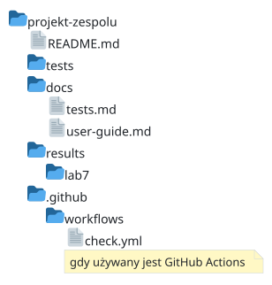

# Laboratorium 7: Testowanie i ocena rezultatów

**Specjalność: Systemy informatyczne w zarządzaniu**

## Cel zajęć

Na tych zajęciach należy sprawdzić, czy zintegrowane rozwiązanie spełnia wymagania, poprawnie obsługuje błędy i daje wiarygodne wyniki. Należy przygotować testy, wykonać jeden pomiar niefunkcjonalny oraz sprawdzić dokumentację przez uruchomienie projektu przez inną osobę.

**Test funkcjonalny** sprawdza zachowanie, np. odrzucenie niepoprawnego pliku. **Test niefunkcjonalny** sprawdza właściwość działania, np. czas przetwarzania ustalonej liczby rekordów. **Test regresyjny** chroni przed ponownym wystąpieniem wcześniej naprawionego błędu; nie oznacza testowania modelu regresji statystycznej.

Nie należy od nowa wykonywać całego doboru metod z Lab 4. Trzeba wykorzystać zapisane tam miary i ograniczenia oraz sprawdzić je na aktualnej implementacji.

## Przygotowanie przed zajęciami

Należy przygotować działającą wersję z Lab 6, instrukcję uruchomienia i dozwolone dane testowe. Trzeba wybrać wymaganie oraz wcześniej ustalone kryterium jakości lub czasu. Jeśli kryterium nie jest jeszcze określone, należy ustalić je przed pomiarem i uzasadnić potrzebą użytkownika.

Testy należy wykonywać na kopiach danych lub w katalogach tymczasowych, nie na `data/raw/` ani na bazie produkcyjnej. Nie należy wykonywać testów obciążeniowych (ang. *load tests*) cudzych API; do tego służy lokalna aplikacja lub usługa, do której testowania zespół ma uprawnienia.

## Rezultat pracy



| Ścieżka | Zawartość |
|---|---|
| `README.md` | aktualna instrukcja instalacji, uruchomienia kodu oraz wykonania testów |
| `tests/` | automatyczne testy logiki i integracji własnego projektu |
| `docs/tests.md` | plan testów, warunki wykonania, wyniki, statusy wymagań i ograniczenia |
| `docs/user-guide.md` | instrukcja użycia głównego przepływu, interpretacja wyniku i opis komunikatów błędów |
| `results/lab7/` | dozwolone wyniki pomiarów niefunkcjonalnych i raporty testów |
| `.github/workflows/check.yml` | konfiguracja automatycznego sprawdzenia (jeśli w projekcie używany jest GitHub Actions) |

Nie należy publikować logów z kluczami, danymi osobowymi ani prywatnymi ścieżkami. W raporcie trzeba wskazać commit sprawdzanej implementacji i wersję próbki.

## Przebieg zajęć — 90 minut

### 1. Plan i kryteria — 0–15 min

Należy przygotować w `docs/tests.md` co najmniej pięć przypadków własnego projektu, obejmujących poprawne, błędne, puste i graniczne wejście. Przed wykonaniem trzeba zapisać oczekiwany wynik; rzeczywistego wyniku nie wolno dopasowywać do oczekiwania po fakcie.

| ID | Wymaganie / przypadek | Wejście | Oczekiwany wynik |
|---|---|---|---|
| T-01 | Prognoza z ostatnich 3 dni | 12, 14, 13, 15; okno 3 | 14,0 zgłoszenia/dzień |
| T-02 | Minimalna historia | 14, 13, 15; okno 3 | Wynik 14,0, bez błędu |
| T-03 | Za krótka historia | 14, 13; okno 3 | Błąd, brak nowego pliku wyniku |
| T-04 | Puste wejście | Pusta lista | Błąd wskazujący brak historii |
| T-05 | Niepoprawna wartość | Liczba ujemna lub tekst | Odrzucenie wejścia, nie wynik 0 |
| T-06 | Ochrona wyniku | Istniejący plik wyjściowy | Odmowa nadpisania, stara zawartość bez zmian |

Trzeba podzielić odpowiedzialność za testy logiki, test całego przepływu, pomiar i sprawdzenie dokumentacji. Każda osoba powinna dostarczyć wynik możliwy do odtworzenia.

W tym samym pliku należy zapisywać wyniki wykonania, osobno od planu. Poniższy wiersz jest szablonem do uzupełnienia, a nie wynikiem przeprowadzonego testu:

| Data i czas uruchomienia | Wersja (commit) | Środowisko / OS | ID testu | Wynik | Czas [s] | Uwagi / dowód |
|---|---|---|---|---|---:|---|
| do uzupełnienia | identyfikator | system, runtime i zależności | T-01 | NOT RUN | — | polecenie i ścieżka do raportu |

Po wykonaniu należy wpisać `PASS` albo `FAIL`, zmierzony czas i dowód. Dla niewykonanej kontroli trzeba zachować `NOT RUN` i podać powód. Należy zaznaczyć, czy czas obejmuje pojedynczy przypadek, czy cały zestaw; nie wpisywać czasu całego zestawu jako czasu każdego testu. Po poprawce kodu należy dodać nowy wynik z nowym commitem zamiast usuwać poprzedni nieudany test.

### 2. Automatyczne sprawdzenia — 15–40 min

Należy dodać co najmniej trzy testy automatyczne własnej logiki, w tym poprawny wynik i błąd, oraz jeden test integracyjny głównego przepływu. **Test integracyjny** sprawdza połączone elementy, np. odczyt pliku, analizę i zapis wyniku.

Testów nie należy ograniczać do sprawdzenia, czy plik istnieje. Trzeba kontrolować także zawartość, jednostki, liczbę przypadków lub oczekiwany komunikat. Należy zachować istniejące kontrole jakości danych z Lab 3.

### 3. Wykrycie problemu i pomiar — 40–65 min

Należy uruchomić testy i opisać znaleziony problem w Issue: wejście, kroki odtworzenia, oczekiwanie i rzeczywisty wynik. Po poprawce trzeba ponowić testy. Jeśli nie wykryto błędu, nie należy go wymyślać; można na lokalnej gałęzi celowo zmienić warunek brzegowy i sprawdzić, czy test to wykryje, a następnie cofnąć tylko własną zmianę.

Trzeba przeprowadzić jeden pomiar niefunkcjonalny: np. czas pełnej analizy dla określonej liczby rekordów, zużycie pamięci albo odtworzenie instalacji w nowym środowisku. Warunki, powtórzenia i kryterium należy zapisać razem z wynikiem.

### 4. Automatyzacja i przegląd dokumentacji — 65–80 min

Należy uruchomić te same testy w automatycznej kontroli repozytorium lub przygotować jedno udokumentowane polecenie lokalne, jeśli automatyzacja jest niedostępna. Osoba niebędąca autorem głównego modułu powinna sprawdzić instalację, uruchomienie i opis błędu w instrukcji użytkowej.

### 5. Ocena wymagań — 80–90 min

W planie należy dopisać wynik, dowód i status każdego wymagania: spełnione, niespełnione albo niesprawdzone. Trzeba wskazać otwarte błędy, ich wpływ i sposób obejścia, jeżeli istnieje. Nie należy utożsamiać wszystkich zielonych testów z potwierdzeniem pełnej użyteczności systemu.

## Przydatne narzędzia

| Narzędzie | Zastosowanie | Dowód |
|---|---|---|
| pytest albo odpowiednik technologii projektu | testy logiki i integracji | testy oraz wynik ich uruchomienia |
| GitHub Actions | automatyczne uruchomienie po zmianie | log zadania przypisany do commita |
| Bruno / Postman | kontrola odpowiedzi API | żądanie, asercje, wynik; bez sekretów |
| DataGrip | kontrole relacji i reguł danych | zapytania kontrolne i liczebności naruszeń |
| Terminal / profiler IDE | pomiar działania | surowe wyniki powtórzeń i warunki |

Należy wybrać narzędzia pasujące do projektu, nie wykonywać wszystkich demonstracji.

### Testowanie funkcji prognozującej i interfejsu wiersza poleceń (pytest)

Demonstracja wykorzystuje `examples/lab6/forecast.py` z [Lab 6](../lab6/). Jeśli wcześniej jej nie wykonywano, należy najpierw zapisać tamten kod. W aktywnym środowisku wirtualnym należy zainstalować `pytest` poleceniem `python -m pip install pytest` i zapisać wersję w zależnościach testowych projektu.

Poniższy kod należy umieścić w `examples/lab6/test_forecast.py` obok kodu demonstracyjnego utworzonego w Lab 6 (testy własnego rozwiązania umieszcza się natomiast w katalogu `tests/`). Import zakłada uruchomienie z katalogu głównego repozytorium; nie trzeba dodawać `examples/` do kodu własnej aplikacji.

```python
import json
from pathlib import Path
import subprocess
import sys
import pytest
from examples.lab6.forecast import forecast

def test_result():
    assert forecast([12, 14, 13, 15], 3) == pytest.approx(14.0)

def test_minimum_history():
    assert forecast([14, 13, 15], 3) == pytest.approx(14.0)

@pytest.mark.parametrize("history,window", [
    ([], 3), ([1, 2], 3), ([1, -2, 3], 3),
    ([1, float("nan"), 3], 3), ([1, 2, 3], 0), ([1, "brak", 3], 3),
])
def test_invalid(history, window):
    with pytest.raises(ValueError):
        forecast(history, window)

def test_command_and_overwrite(tmp_path):
    source = tmp_path / "history.json"
    target = tmp_path / "result.json"
    source.write_text("[12, 14, 13, 15]", encoding="utf-8")
    script = Path(__file__).with_name("forecast.py")
    command = [sys.executable, str(script), str(source), str(target), "--window", "3"]
    first = subprocess.run(command, capture_output=True)
    assert first.returncode == 0, first.stderr
    result = json.loads(target.read_text(encoding="utf-8"))
    assert result["forecast"] == pytest.approx(14.0)
    assert result["unit"] == "zgloszenia/dzien"
    saved = target.read_bytes()
    second = subprocess.run(command, capture_output=True)
    assert second.returncode != 0
    assert target.read_bytes() == saved
```

Należy wykonać:

```powershell
python -m pytest examples/lab6/test_forecast.py -q
```

Oczekiwany rezultat to `9 passed`. Parametryzacja uruchamia sześć wariantów niepoprawnego wejścia. `tmp_path` dostarcza osobny katalog testowy, a `pytest.approx` pozwala porównywać liczby zmiennoprzecinkowe z tolerancją. Zasady uruchamiania opisano w [dokumentacji pytest](https://docs.pytest.org/en/stable/getting-started.html).

**Ćwiczenie:** należy dopisać test całego polecenia dla historii krótszej od okna: kod wyjścia ma być niezerowy, a plik wyniku nie może powstać. Następnie na lokalnej gałęzi należy zmienić warunek `len(history) < window` na `len(history) <= window`. Test minimalnej historii powinien wykryć błąd. Po przywróceniu prawidłowego warunku wszystkie testy powinny przejść.

Dla własnego projektu należy umieścić testy w `tests/`, zmienić importy i dobrać przypadki do własnej specyfikacji interfejsu. Dla API należy dodatkowo sprawdzić kod odpowiedzi i strukturę danych, a dla bazy — działanie ograniczeń. Nie należy traktować testów demonstracji jako testów własnego systemu.

### Sprawdzenie wybranego interfejsu (FastAPI / Streamlit — opcjonalnie)

Należy wykonać tylko wariant interfejsu wybrany w Lab 6. Przykłady zakładają uruchamianie z katalogu głównego repozytorium. Nie trzeba uruchamiać serwera ani przeglądarki, aby wykonać poniższe testy.

**FastAPI:** w środowisku z `fastapi` i `pytest` należy zainstalować `httpx`, a kod zapisać jako `examples/lab6/test_api.py`:

```python
import pytest
from fastapi.testclient import TestClient
from examples.lab6.server import app

def test_api_success():
    with TestClient(app) as client:
        response = client.post("/api/forecast", json={"history": [12, 14, 13, 15], "window": 3})
    assert response.status_code == 200
    assert response.json() == {"forecast": 14.0, "unit": "zgloszenia/dzien", "window": 3}

@pytest.mark.parametrize("body,status,error", [
    ('{"history":', 400, "invalid_json"),
    ('{"history":[12,14],"window":3}', 422, "invalid_history"),
    ('{"history":[12,-1,15],"window":3}', 422, "invalid_history"),
    ('{"history":[12,14,15],"window":0}', 422, "invalid_history"),
])
def test_api_error(body, status, error):
    with TestClient(app) as client:
        response = client.post("/api/forecast", content=body,
                               headers={"Content-Type": "application/json"})
    assert response.status_code == status
    assert response.json() == {"error": error}
```

Polecenie `python -m pytest examples/lab6/test_api.py -q` powinno dać `5 passed`. Klient testowy sprawdza aplikację w procesie testu, ale nie konfigurację sieci, TLS ani wdrożenie. Te elementy wymagają oddzielnej kontroli w docelowym środowisku.

**Streamlit:** w środowisku z `streamlit` i `pytest` należy zapisać kod jako `examples/lab6/test_dashboard.py`:

```python
from pathlib import Path
from streamlit.testing.v1 import AppTest

def test_dashboard():
    path = Path(__file__).with_name("dashboard.py")
    app = AppTest.from_file(str(path), default_timeout=15).run()
    assert not app.exception
    assert app.metric[0].value == "14.0"
    app.slider[0].set_value(1).run()
    assert not app.exception
    assert app.metric[0].value == "15.0"
    app.slider[0].set_value(5).run()
    assert not app.exception
    assert len(app.error) == 1
    assert len(app.metric) == 0
```

Polecenie `python -m pytest examples/lab6/test_dashboard.py -q` powinno dać `1 passed`. `AppTest` sprawdza reakcję aplikacji na zmianę kontrolki; nie ocenia czytelności wykresu ani wyglądu w przeglądarce. Należy dodatkowo obejrzeć widok ręcznie. Mechanizm opisuje [dokumentacja testowania Streamlit](https://docs.streamlit.io/develop/api-reference/app-testing/st.testing.v1.apptest).

**Ćwiczenie:** należy rozszerzyć wybraną ścieżkę o puste wejście i brak obowiązkowego pola lub niepoprawny tekst. Testy logiki z poprzedniej sekcji należy zachować — test interfejsu nie zastępuje kontroli obliczeń.

### Pomiar pokrycia kodu testami i analiza statyczna (pytest-cov / Ruff — opcjonalnie)

W aktywnym środowisku należy wykonać `python -m pip install pytest-cov ruff`. Dla demonstracji można uruchomić:

```powershell
python -m pytest examples/lab6/test_forecast.py --cov=examples.lab6.forecast --cov-branch --cov-report=term-missing
python -m ruff check examples/lab6
```

W projekcie trzeba zastąpić ścieżki własnym pakietem i testami. **Pokrycie kodu testami** (ang. *code coverage*) wskazuje wykonane przez testy linie i gałęzie programu. W kolumnie brakujących fragmentów należy wybrać jeden ważny, niepokryty przypadek i dopisać test sprawdzający jego zachowanie. Kod uruchamiany w osobnym procesie wymaga dodatkowej konfiguracji pomiaru; samo wykonanie testu CLI nie oznacza, że jego wnętrze uwzględniono w tym raporcie. Opcje raportowania opisuje [dokumentacja pytest-cov](https://pytest-cov.readthedocs.io/en/latest/reporting.html).

Ruff wykonuje analizę statyczną (ang. *static analysis*), czyli sprawdza kod bez uruchamiania badanego programu. Wykrywa m.in. nieużywane importy, niezdefiniowane nazwy i problemy składniowe. Należy przeczytać wskazaną regułę i poprawić przyczynę; nie wyłączać kontroli tylko dla uzyskania zielonego wyniku. Na początek trzeba używać `check` bez automatycznego `--fix` i przejrzeć każdą zmianę. Zakres reguł opisuje [samouczek Ruff](https://docs.astral.sh/ruff/tutorial/).

Wysokie pokrycie i brak uwag lintera nie dowodzą poprawności biznesowej ani skuteczności modelu. Nie trzeba dążyć do arbitralnego 100% kosztem sensownych asercji. Po lokalnym sprawdzeniu można dodać te polecenia do istniejącego workflow wraz z instalacją potrzebnych pakietów.

### Sprawdzenie reguł danych (SQL / DataGrip)

Dla wariantu bazodanowego należy sprawdzić kopię bazy z Lab 5–6. Zapytania należy zachować jako `examples/lab7/check_data.sql`, a dla własnego projektu w `tests/sql/`. Poniższe zapytanie powinno zwrócić trzy wiersze z liczbą naruszeń równą 0:

```sql
SELECT 'invalid_forecast' AS rule, COUNT(*) AS violations
FROM forecast WHERE value IS NULL OR value < 0
UNION ALL
SELECT 'missing_run', COUNT(*)
FROM forecast f LEFT JOIN run r ON r.id = f.run_id
WHERE r.id IS NULL
UNION ALL
SELECT 'invalid_window', COUNT(*)
FROM run WHERE window IS NULL OR window <= 0;
```

Zero naruszeń nie dowodzi kompletności — pusta baza również zwróci zera. Należy dodatkowo sprawdzić oczekiwaną liczbę wyników dla wybranego `run_id` oraz obecność wymaganych dat. W demonstracji każde zapisane uruchomienie powinno mieć jedną prognozę. Samo wykonanie `SELECT` nie spowoduje niepowodzenia CI: skrypt automatyczny musi odczytać wynik i zakończyć się błędem, gdy `violations > 0` lub liczebność jest niezgodna z oczekiwaniem.

**Ćwiczenie:** na kopii bazy należy sprawdzić odrzucenie ujemnej prognozy, duplikatu klucza i odwołania do nieistniejącego uruchomienia. Trzeba włączyć `PRAGMA foreign_keys = ON` w używanym połączeniu SQLite. Po próbie nieudanego zapisu należy potwierdzić, że stan bazy się nie zmienił. Jeśli baza odrzuca błędny rekord, jest to oczekiwany sukces testu ograniczenia, nie awaria testu.

### Sprawdzenie odpowiedzi API (Postman)

Ścieżka dotyczy zespołów mających API; nie trzeba budować serwera wyłącznie dla tego ćwiczenia. Poniższe żądania odnoszą się do przykładowej specyfikacji z Lab 5. Należy najpierw uruchomić własną usługę i ustawić jej lokalny adres jako zmienną `base_url`, np. `http://127.0.0.1:8000`, jeśli używa tego portu.

1. Utworzyć żądanie `POST {{base_url}}/api/forecast`.
2. W **Body → raw → JSON** wpisać `{"history":[12,14,13,15],"window":3}`.
3. W **Scripts → Post-response** dodać poniższe testy i wysłać żądanie.
4. W **Test Results** sprawdzić wynik każdej asercji; sam HTTP 200 nie potwierdza poprawnej prognozy.

```javascript
pm.test("HTTP 200", () => pm.response.to.have.status(200));
pm.test("Wynik i jednostka zgodne ze specyfikacją", () => {
    const body = pm.response.json();
    pm.expect(body.forecast).to.be.a("number");
    pm.expect(body.forecast).to.be.closeTo(14.0, 1e-9);
    pm.expect(body.unit).to.eql("zgloszenia/dzien");
    pm.expect(body.window).to.eql(3);
});
```

Należy utworzyć osobne żądania dla błędów i nadać im własne asercje:

| Przypadek | Body | Oczekiwanie według specyfikacji z Lab 5 |
|---|---|---|
| Zbyt krótka historia | `{"history":[12,14],"window":3}` | HTTP 422, `error` równe `invalid_history` |
| Błędny JSON | `{"history":` | HTTP 400, `error` równe `invalid_json` |

Dla drugiego przypadku należy zachować `Content-Type: application/json`, mimo że treść jest niepoprawna. Nie należy zmieniać oczekiwanego kodu tylko dlatego, że serwer zwraca inny — najpierw trzeba rozstrzygnąć niezgodność implementacji z opisem w dokumentacji.

**Ćwiczenie:** należy zapisać trzy żądania wraz z testami w kolekcji, uruchomić ją ponownie i wyeksportować bez sekretów do `api/`. Te same sprawdzenia można wykonać w Bruno według przewodnika w Lab 3. Mechanizm asercji opisano w [dokumentacji Postmana](https://learning.postman.com/docs/tests-and-scripts/write-scripts/test-scripts/). Dla operacji zapisującej dane trzeba również sprawdzić stan bazy lub plików: brak zapisu po błędzie i zgodność rekordów po sukcesie.

### Porównanie jakości wyniku po integracji

Należy sprawdzić nie tylko funkcję analityczną, lecz wynik uzyskany przez rzeczywisty interfejs projektu: CLI, API, odczyt z bazy lub eksport dashboardu.

1. Odtworzyć wersję próbki, podział na historię i okres oceny, parametry oraz miarę zapisane w Lab 4.
2. Dla każdego przypadku testowego wykonać pełną operację za pomocą interfejsu projektu, bez używania przyszłych danych w prognozie. Zapisać wyniki jednostkowe w `results/lab7/analytical-observations.csv`.
3. Dopasować prognozy do wartości rzeczywistych po identyfikatorze lub dacie, nie tylko po pozycji wiersza. Sprawdzić brakujące, nadmiarowe i powtórzone wyniki.
4. Obliczyć tę samą miarę i porównać z Lab 4 oraz ustalonym kryterium. Zapisać wynik i tolerancję numeryczną w `docs/tests.md`.

Dla demonstracji z Lab 4 trzeba ocenić dni 9–12 października, każdorazowo podając wyłącznie dostępną historię. Przy oknie 3 oczekiwane MAE wynosi 1,0 zgłoszenia, a dla ostatniej znanej wartości 1,5. Różnica ponad uzgodnioną tolerancję, np. `1e-9` dla tej demonstracji, wymaga sprawdzenia filtrów, jednostek, zaokrągleń i parametrów. Nie należy zastępować tego sprawdzenia pojedynczą prognozą 14,0 z Lab 6.

Dla symulacji należy zachować scenariusze i ziarna, a dla innych analiz — ich właściwą miarę. Jeżeli metoda lub dane zostały świadomie zmienione, trzeba zapisać nowy eksperyment, zamiast oczekiwać identycznej liczby. Pogorszenie po integracji należy wyjaśnić przed uznaniem wymagania za spełnione.

### Automatyczne uruchamianie testów po push i w Pull Request (GitHub Actions)

Dla demonstracji należy zapisać poniższy workflow jako `.github/workflows/check.yml`. Jeśli plik już istnieje, należy rozszerzyć go, a nie nadpisywać dotychczasowych zadań.

```yaml
name: Check
on: [push, pull_request]
permissions:
  contents: read
jobs:
  tests:
    runs-on: ubuntu-latest
    steps:
      - uses: actions/checkout@v6
      - uses: actions/setup-python@v5
        with:
          python-version: "3.12"
      - run: python -m pip install pytest
      - run: python -m pytest examples/lab6/test_forecast.py -q
```

Dla własnego rozwiązania należy zastąpić instalację zależności odpowiednim plikiem projektu i uruchamiać `python -m pytest tests -q` lub odpowiednik innej technologii. Należy zapisać wersje używanych zależności; powyższy minimalny przykład nie przypina wersji pytest.

Po pushu trzeba otworzyć **Actions → Check → konkretne uruchomienie → tests** i rozwinąć krok testów. Należy sprawdzić liczbę wykonanych testów, a nie tylko kolor ikony. Po celowym błędzie kontrola powinna zakończyć się niepowodzeniem; po poprawce należy ponowić ją dla nowego commita. Szczegóły zawiera [dokumentacja workflow dla Pythona](https://docs.github.com/en/actions/tutorials/build-and-test-code/python).

Nieudana kontrola nie zawsze automatycznie blokuje scalenie PR. Takie wymuszenie zależy od reguł ochrony gałęzi i wymaganych kontroli. Nie należy scalać znanej błędnej zmiany tylko dlatego, że interfejs na to pozwala. W logach nie wolno wypisywać sekretów.

Administrator repozytorium może wymusić tę zasadę: po pierwszym wykonaniu workflow należy otworzyć **Settings → Branches**, dodać regułę ochrony dla właściwej gałęzi (`main` lub `master`), zaznaczyć **Require a pull request before merging** i **Require status checks to pass before merging**, a następnie wybrać rzeczywistą kontrolę testów z listy. Nie należy wpisywać przypadkowej nazwy — brak takiej kontroli może blokować wszystkie PR. Dostępność opcji zależy od uprawnień i zasad organizacji; szczegóły opisuje [dokumentacja ochrony gałęzi](https://docs.github.com/en/repositories/configuring-branches-and-merges-in-your-repository/managing-protected-branches/managing-a-branch-protection-rule).

**Ćwiczenie:** na gałęzi testowej należy doprowadzić do niepowodzenia znanej asercji, otworzyć PR i sprawdzić blokadę scalenia dla zwykłego członka zespołu. Następnie trzeba przywrócić poprawny kod i sprawdzić nowy wynik kontroli. Uprawnienia administratora lub wyjątki od reguł mogą pozwalać na obejście blokady; nie należy z nich korzystać do scalania błędnej wersji.

### Pomiar czasu na ustalonej próbce (Python)

Należy mierzyć konkretnie określony zakres, np. samo obliczenie albo cały proces z odczytem i zapisem. Poniższy przykład mierzy wyłącznie funkcję `forecast`; nie mierzy czasu API ani zapisu na dysk.

Kod należy zapisać jako `examples/lab6/benchmark.py` i uruchomić z katalogu głównego przez `python -m examples.lab6.benchmark`.

```python
import csv
import platform
from pathlib import Path
from statistics import median
from time import perf_counter
from examples.lab6.forecast import forecast

history = [14.0] * 100_000
forecast(history, 3)  # rozgrzewka, poza pomiarem
rows = []
for repeat in range(1, 6):
    start = perf_counter()
    result = forecast(history, 3)
    elapsed = perf_counter() - start
    assert result == 14.0
    rows.append({"repeat": repeat, "n": len(history), "window": 3,
                 "seconds": elapsed, "python": platform.python_version()})
out = Path("examples/lab6/results/timing.csv")
out.parent.mkdir(parents=True, exist_ok=True)
with out.open("w", encoding="utf-8", newline="") as stream:
    writer = csv.DictWriter(stream, fieldnames=list(rows[0]))
    writer.writeheader()
    writer.writerows(rows)
print("Mediana [s]:", median(row["seconds"] for row in rows))
```

Nie ma jednej oczekiwanej liczby sekund: wynik zależy od sprzętu i środowiska. Należy podać medianę, minimum i maksimum, zapisać sprzęt, system, obciążenie i wersję kodu. **Mediana** to środkowy wynik po uporządkowaniu pomiarów; pomaga ograniczyć wpływ pojedynczego wolnego uruchomienia.

**Ćwiczenie:** należy zwiększyć próbkę dziesięciokrotnie, zmienić nazwę pliku wynikowego i powtórzyć pomiar. Trzeba wyjaśnić, dlaczego walidacja całej historii wpływa na czas, mimo że średnia korzysta tylko z trzech końcowych wartości. Nie należy usuwać kontroli danych wyłącznie dla poprawienia wyniku pomiaru.

W projekcie należy zapisać wyniki w `results/lab7/` i odnieść je do kryterium użytkownika, np. „raport dla 10 000 rekordów w mniej niż 2 sekundy na wskazanym stanowisku”. Taki próg jest przykładem, nie uniwersalnym wymaganiem.

### Sprawdzenie dokumentacji i jakości rozwiązania

Należy oddzielić dwa opisy:

| Dokument | Co musi pozwolić zrobić? |
|---|---|
| README i dokumentacja techniczna | Odtworzyć środowisko, skonfigurować projekt, uruchomić kod i testy; zrozumieć moduły i zależności |
| `docs/user-guide.md` | Wykonać operację użytkownika, odczytać wynik i zareagować na znany błąd |

Przykład instrukcji użytkowej: „Należy wskazać plik dziennych liczebności i okno 3. Wynik podaje prognozę na następny dzień w zgłoszeniach/dzień. Komunikat o zbyt krótkiej historii wymaga uzupełnienia danych; nie należy interpretować go jako zerowego zapotrzebowania”.

Minimalny układ `docs/user-guide.md`:

```markdown
# Instrukcja użytkownika

## 1. Wymagane dane wejściowe
- Format, wymagane kolumny/pola i dopuszczalne zakresy wartości:

## 2. Wykonanie operacji krok po kroku
- Polecenie uruchomienia lub kroki w interfejsie:

## 3. Interpretacja wyniku
- Co oznaczają zwracane wartości, jednostki i ograniczenia wnioskowania:

## 4. Komunikaty błędów i sposób postępowania
- Najczęstsze błędy wejścia lub wykonania i zalecana reakcja użytkownika:
```

Inna osoba powinna wykonać opisane kroki bez ustnych podpowiedzi autora i zanotować pierwszy brakujący krok. Trzeba także sprawdzić: jednostki, pochodzenie próbki, brak sekretów, powtarzalność, czytelność funkcji i zgodność dokumentacji z implementacją. Wynik analityczny należy porównać z miarą z Lab 4; testy kodu nie zastępują oceny reprezentatywności danych.

## Zadania samodzielne

1. Przygotować co najmniej pięć przypadków testowych powiązanych z wymaganiami.
2. Dodać co najmniej trzy automatyczne testy logiki i jeden test integracyjny własnego rozwiązania.
3. Potwierdzić, że test wykrywa rzeczywisty błąd lub kontrolowaną zmianę warunku; nie pozostawiać celowej usterki w wersji głównej.
4. Wykonać jeden pomiar niefunkcjonalny w opisanych warunkach i porównać go z kryterium.
5. Obliczyć miarę jakości dla wyników całego systemu i porównać ją z wynikiem eksperymentu z Lab 4; zapisać dowody oceny danych, wyników i kodu oraz ograniczenia.
6. Uruchomić automatyczną kontrolę lub udokumentować przeszkodę i równoważne sprawdzenie lokalne.
7. Uzupełnić dokumentację techniczną i użytkową; sprawdzić ją przez uruchomienie przez inną osobę.
8. Przypisać statusy wymaganiom i pozostawić niespełnione jako jawne zadania.

## Rezultat do zapisania

- `tests/` i polecenie uruchomienia;
- `docs/tests.md`: plan, wersja kodu i danych, wyniki, statusy wymagań oraz ograniczenia;
- `results/lab7/`: dozwolone wyniki pomiarów;
- aktualne README, dokumentacja techniczna i `docs/user-guide.md`;
- wynik kontroli repozytorium i odnośniki do problemów oraz poprawek;
- sprawdzalny wkład każdej osoby.
