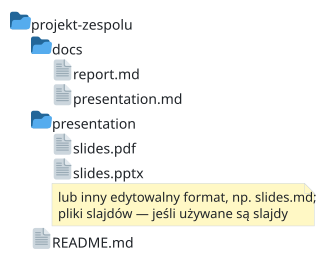

# Laboratorium 8: Prezentacja rezultatów projektu

**Specjalność: Systemy informatyczne w zarządzaniu**

## Cel zajęć

Na tym etapie należy przygotować raport końcowy i przedstawić działanie projektu, uzasadnienie decyzji oraz wyniki oceny. Trzeba wskazać dokładną wersję rozwiązania i indywidualny wkład członków zespołu. Prezentacja powinna pokazać, jak rozwiązanie wspiera konkretną decyzję użytkownika, a nie tylko jakie technologie wykorzystano.

## Przygotowanie przed zajęciami

Należy przygotować zintegrowaną wersję z Lab 6, wyniki testów z Lab 7, dokumentację i dozwoloną próbkę demonstracyjną. Przed wystąpieniem trzeba sprawdzić pełny scenariusz na komputerze używanym do pokazu oraz przygotować lokalny wariant awaryjny.

Należy wcześniej zebrać pliki z wynikami i przejrzeć poniższe przykłady. Podczas zajęć trzeba opracować własne rezultaty; nie ma obowiązku wykonywania wszystkich demonstracji narzędziowych. W razie braku działającej wersji należy wskazać wykonany zakres i przeszkodę zamiast zastępować wynik planem przyszłej pracy.

Należy uzgodnić z prowadzącym limit wystąpienia i sposób przekazania materiałów. Poniższy podział 90 minut dotyczy przygotowania i prób; kolejność oraz czas prezentacji końcowych zależą od harmonogramu grupy.

## Rezultat pracy



| Ścieżka | Zawartość |
|---|---|
| `docs/report.md` | Raport końcowy z odnośnikami do istniejących dowodów |
| `docs/presentation.md` | Scenariusz demonstracji, pytania i wynik próby |
| `presentation/slides.pdf` | Czytelny eksport prezentacji, jeśli używane są slajdy |
| `presentation/slides.pptx` | Źródło slajdów; dopuszczalny inny edytowalny format, np. `slides.md` |
| `README.md` | Punkt wejścia do uruchomienia i dokumentacji |
| `examples/lab8/` | Opcjonalne wyniki ćwiczenia demonstracyjnego; oddzielone od rezultatów własnego projektu |

Należy zachować format odpowiedni do narzędzia. Jeśli prezentacja jest przygotowana w usłudze internetowej, trzeba sprawdzić uprawnienia odbiorcy i zapisać eksport, który można otworzyć bez konta autora. Nie należy publikować karty projektu, prywatnych danych ani sekretów. Do raportu wystarczą bezpieczne przykłady i odnośniki do publicznych rezultatów pracy.

## Przebieg zajęć — przygotowanie i próba, 90 minut

### 1. Wybór wersji i kontrola gotowości — 0–15 min

Należy sprawdzić stan repozytorium, uruchomić testy i główny przepływ. Trzeba ustalić, który commit będzie prezentowany, oraz spisać błędy wpływające na demonstrację. Jeśli błąd uniemożliwia główną operację, należy go naprawić lub jawnie ograniczyć zakres pokazu; nie wolno przedstawiać zrzutu ekranu jako działającej aplikacji.

Każda osoba powinna odpowiadać za konkretny rezultat przygotowania: raport, weryfikację wydania, scenariusz, materiały wizualne lub kontrolę dowodów. Każda powinna również umieć wyjaśnić własny wkład w projekt.

Należy uzgodnić edycję wspólnych plików: jedna osoba składa raport, druga scenariusz, kolejna materiały wizualne, a pozostałe sprawdzają wyniki i odtworzenie. Uwagi trzeba przekazywać w przeglądzie Pull Requestu; nie należy jednocześnie nadpisywać tego samego pliku prezentacji.

### 2. Raport końcowy — 15–35 min

Należy uzupełnić `docs/report.md` według struktury poniżej. Nie trzeba przepisywać całej dokumentacji z poprzednich zajęć. Trzeba krótko podsumować wynik i wskazać pliki, testy oraz pomiary potwierdzające najważniejsze stwierdzenia.

### 3. Demonstracja i materiały — 35–55 min

Należy przygotować pokaz jednej ważnej operacji: wejście, wykonanie, wynik i interpretacja. Trzeba dobrać jeden diagram oraz jedną tabelę lub wykres, które pomagają wyjaśnić decyzje. Nie należy umieszczać na slajdach całego README ani zrzutów kodu z nieczytelną czcionką.

### 4. Próba z pomiarem czasu — 55–75 min

Należy przeprowadzić próbę przed inną osobą lub zespołem, z limitem uzgodnionym na zajęciach. Obserwator powinien zanotować: czas, niezrozumiałe pojęcie, stwierdzenie bez dowodu i jedno pytanie dotyczące ograniczeń. Trzeba przećwiczyć przekazanie głosu oraz odszukanie pliku z dowodem.

### 5. Poprawki i wydanie — 75–90 min

Należy poprawić najsłabszy fragment raportu lub wystąpienia, powtórzyć potrzebne sprawdzenia i oznaczyć gotową wersję. Trzeba potwierdzić, że README, raport, wyniki testów i prezentacja odnoszą się do tego samego stanu projektu. Po zmianie kodu nie należy używać starego raportu testów jako dowodu nowej wersji.

## Przygotowanie raportu końcowego

W `docs/report.md` należy zastosować poniższe rozdziały. Długość powinna wynikać z potrzeb wyjaśnienia projektu, nie z wypełniania określonej liczby stron.

| Rozdział | Co zapisać? | Gdzie szukać dowodu? |
|---|---|---|
| Problem i użytkownik | Jaką decyzję lub czynność usprawniono? | `docs/problem.md` |
| Zakres wykonany | Co rzeczywiście działa, a czego nie zrealizowano? | główny przepływ i otwarte Issues |
| Dane | Pochodzenie, jednostka obserwacji, dostęp, jakość i ograniczenia | `docs/data.md`, `docs/processing.md` |
| Metoda i architektura | Powód wyboru, wariant bazowy, kompromisy | `docs/experiment.md`, `docs/architecture.md`, ADR |
| Wyniki i ocena | Miary, dane, wersja, statusy wymagań | `docs/tests.md`, wyniki Lab 4 i Lab 7 |
| Użycie i odtworzenie | Jak uruchomić dokładnie prezentowaną wersję? | `README.md`, `docs/user-guide.md`, tag |
| Ograniczenia i rozwój | Czego wynik nie potwierdza? Jaki jest najważniejszy dalszy krok? | niezweryfikowane założenia i błędy |
| Wkład zespołu i źródła | Rezultaty poszczególnych osób, wykorzystane materiały i wsparcie AI | Issue, PR, commity, literatura |

Minimalny układ `docs/report.md`:

```markdown
# Raport końcowy projektu

## 1. Problem i użytkownik
- Wspierana decyzja użytkownika i sprawdzane wymagania (link do docs/problem.md):

## 2. Zakres wykonany
- Działający główny przepływ oraz elementy niezrealizowane (link do docs/implementation.md i otwartych Issues):

## 3. Dane
- Źródło, jednostka obserwacji, jakość i ograniczenia (link do docs/data.md, docs/data-dictionary.md i docs/processing.md):

## 4. Metoda i architektura
- Wybrana metoda, wariant bazowy i najważniejsze decyzje techniczne (link do docs/experiment.md, docs/architecture.md i ADR):

## 5. Wyniki i ocena
- Uzyskane miary, wyniki testów i statusy wymagań (link do docs/tests.md oraz wyników z Lab 4 i Lab 7):
- Najważniejszy wniosek, warunki porównania i ograniczenie jego zakresu:

## 6. Użycie i odtworzenie
- Prezentowana wersja (tag / commit) i odnośnik do instrukcji uruchomienia (README.md, docs/user-guide.md):

## 7. Ograniczenia i kierunki rozwoju
- Czego uzyskany wynik nie potwierdza i jaki jest uzasadniony kolejny krok:

## 8. Wkład zespołu i źródła
- Indywidualne rezultaty członków zespołu (PR / commity / pliki) oraz wykorzystana literatura i narzędzia AI:
```

### Powiązanie wniosków z wynikami

Należy wybrać trzy najważniejsze stwierdzenia o projekcie i dla każdego wskazać dowód oraz granicę wnioskowania. Poniższe przykłady odnoszą się do demonstracji z Lab 4–7; do raportu należy wpisać własne wyniki.

| Stwierdzenie | Co je potwierdza? | Czego nie można z niego wywnioskować? |
|---|---|---|
| Prognoza dla historii 12, 14, 13, 15 i okna 3 wynosi 14 | Ręczny rachunek `(14 + 13 + 15) / 3` i zgodny wynik testu CLI | Że prognoza będzie dokładna na rzeczywistych danych |
| Średnia z 3 dni ma mniejsze MAE niż ostatnia wartość na próbce demonstracyjnej | Cztery wyniki jednostkowe i MAE 1,0 wobec 1,5 zgłoszenia | Że zmniejszono koszty obsługi lub potwierdzono skuteczność wdrożenia |
| Nieudany zapis prognozy nie pozostawia nowego uruchomienia w bazie | Test wycofania transakcji i porównanie stanu bazy przed błędem i po nim | Że sprawdzono wszystkie możliwe awarie bazy |

Przy miarze należy podać jednostkę, liczebność próby, okres, parametry i wersję danych. Wyniki porównywanych metod muszą dotyczyć tych samych przypadków. Wymagania z Lab 7 trzeba zachować ze statusami „spełnione”, „niespełnione” lub „niesprawdzone”; ograniczenie opisane w raporcie nie zmienia niesprawdzonego wymagania w spełnione.

Linki trzeba zapisywać względem pliku, w którym są umieszczone. Przykładowo w `docs/report.md` poprawne odnośniki do istniejących dokumentów mają postać:

```markdown
[Plan i wyniki testów](./tests.md)
[Instrukcja uruchomienia](../README.md)
[Instrukcja użytkownika](./user-guide.md)
```

W przypadku pliku z wynikiem należy wskazać konkretny raport lub CSV, a nie tylko katalog. Link do dokumentacji biblioteki potwierdza sposób jej użycia, ale nie zastępuje wyniku uruchomienia projektu. Trzeba otworzyć odnośniki w podglądzie repozytorium, ponieważ ścieżka działająca tylko na komputerze autora nie wystarcza.

**Przykład poprawnego wniosku:** „Na czterech syntetycznych dniach średnia z trzech dni uzyskała MAE 1,0 zamiast 1,5 zgłoszenia. Potwierdza to działanie procedury porównawczej, ale nie skuteczność planowania obsady w rzeczywistej organizacji”.

**Przykład wymagający poprawy:** „System zmniejsza koszty obsługi o 30%”, jeśli nie zmierzono kosztów ani skutków wdrożenia. Należy zastąpić go wynikiem, który rzeczywiście uzyskano, i opisać brakujące sprawdzenie.

Wkład należy opisać przez rezultat, nie przez liczbę commitów. Przykładowy zapis: „Walidacja braków w imporcie — PR #18; test odrzucenia pustej próbki — plik testu; sprawdzenie integracji — wynik uruchomienia”. Nie należy tworzyć dodatkowej publicznej listy danych osobowych; sposób identyfikacji osób na potrzeby oceny należy uzgodnić z prowadzącym.

W wykazie źródeł należy podać autora lub instytucję, tytuł, adres i datę dostępu do źródła internetowego. Trzeba wskazać także źródła danych, wykorzystane fragmenty kodu i licencje, korzystając z ustaleń z Lab 2–4. Dla wsparcia AI wystarczy opisać narzędzie, zakres pomocy i sposób samodzielnego sprawdzenia wyniku. Odpowiedź czatu nie zastępuje publikacji ani dokumentacji źródłowej.

## Audyt gotowości projektu

Przed oznaczeniem wersji należy sprawdzić poniższe elementy i zapisać w `docs/report.md` brakujące dowody lub ograniczenia. Nie trzeba tworzyć kopii istniejących plików; wystarczą odnośniki. „Nie dotyczy” wymaga uzasadnienia, np. brak automatycznego sprawdzania w GitHub Actions wraz z opisanym lokalnym poleceniem testowym.

| Etap | Co sprawdzić? | Dowód / miejsce |
|---|---|---|
| Lab 1 — karta | Czy końcowy zakres odpowiada problemowi i czy wyjaśniono zmiany? | karta przekazana prywatnie; bez jej kopii i prywatnego linku w repozytorium |
| Lab 2–3 — dane | Pochodzenie, prawo użycia, słownik, kontrola jakości i odtworzenie przetwarzania | `docs/data.md`, `docs/processing.md`, dozwolona próbka i skrypt |
| Lab 4 — metoda | Wariant bazowy, parametry, wspólne warunki oceny i ograniczenia | `docs/experiment.md`, wyniki porównania |
| Lab 5 — projekt | Zgodność diagramów i specyfikacji interfejsów z implementacją | `docs/architecture.md`, diagramy i ADR |
| Lab 6 — realizacja | Działający główny przepływ i zintegrowane zmiany | kod, README, PR i `docs/implementation.md` |
| Lab 7 — ocena | Wykonane testy, miara całego przepływu, otwarte błędy | `docs/tests.md`, `docs/user-guide.md`, wyniki, GitHub Actions lub udokumentowane polecenie lokalne |
| Wydanie | Czy oznaczono dokładnie sprawdzoną wersję? | tag/commit i wynik odtworzenia |
| Lab 8 — przekazanie | Spójny raport, prezentacja, demonstracja i wkład | `docs/report.md`, `docs/presentation.md`, materiały oraz PR |

Nie należy ukrywać brakującego elementu przez oznaczenie go jako ukończonego. Trzeba wskazać jego wpływ na użyteczność lub możliwość oceny projektu.

## Przydatne narzędzia

| Narzędzie | Co wykonać? | Co sprawdzić? |
|---|---|---|
| Markdown / podgląd repozytorium | raport z odnośnikami | działające linki i czytelne tabele |
| Git i GitHub Releases | oznaczenie prezentowanej wersji | tag wskazuje sprawdzony commit |
| PowerPoint / LibreOffice Impress / Google Slides | slajdy i eksport PDF | czytelność na ekranie, brak prywatnych danych |
| Tryb prezentera i timer | próba wystąpienia | czas, kolejność, przejście do demonstracji |
| Środowisko projektu | rzeczywisty pokaz | wejście, wynik, jednostki i zachowanie przy błędzie |

Nie trzeba używać wszystkich narzędzi. Wykres powinien pochodzić z zapisanych wyników, a zrzut ekranu — z rzeczywistego działania aplikacji. Nie należy zastępować dowodów grafiką wygenerowaną przez AI.

### Oznaczenie sprawdzonej wersji (Git / GitHub Releases)

**Tag** nadaje nazwę konkretnemu stanowi repozytorium. **Release** pozwala dodatkowo dołączyć opis wydania i pliki. Przed oznaczeniem należy zakończyć integrację kodu, raportu i materiałów, a następnie sprawdzić stan repozytorium:

```bash
git status
git rev-parse HEAD
git log -1 --oneline
```

Należy przejrzeć ewentualne niezapisane zmiany. Kod, konfiguracja i dozwolone dane potrzebne do odtworzenia muszą być zapisane w commitach; lokalne środowisko wirtualne i pliki poufne pozostają poza repozytorium. Na tej wersji trzeba wykonać polecenie testowe i scenariusz demonstracji. Raport z Lab 7 zachowuje identyfikator faktycznie sprawdzanego commita. Jeżeli od tego czasu zmieniono jedynie dokumentację, należy wskazać tę różnicę; po zmianie kodu, zależności lub danych potrzebne jest nowe sprawdzenie.

W `docs/report.md` i `docs/presentation.md` można z wyprzedzeniem wpisać planowaną nazwę taga, a jego identyfikator commita odczytać po utworzeniu. Nie należy próbować zapisywać w pliku identyfikatora commita, który dopiero powstanie wskutek zapisania tego pliku.

Po sprawdzeniu można utworzyć nowy tag; poniższa nazwa jest przykładowa i musi być wolna:

```bash
git tag -a v1.0.0 -m "Wersja do prezentacji projektu"
git rev-parse "v1.0.0^{commit}"
git push origin v1.0.0
```

Nie należy przesuwać już udostępnionego taga na poprawioną wersję. Dla zmiany wymagającej ponownej oceny trzeba utworzyć kolejny tag i powtórzyć sprawdzenia. Przed wysłaniem taga należy upewnić się, że jego commit jest też dostępny w zdalnym repozytorium zespołu.

Opcjonalnie można przygotować wydanie na GitHubie. Należy otworzyć **Releases → Draft a new release**, wskazać istniejący tag i dodać: zakres działający, polecenie uruchomienia, odnośnik do raportu oraz znane ograniczenia. Następnie trzeba sprawdzić załączniki i opublikować wydanie. Szczegóły opisano w [dokumentacji GitHub Releases](https://docs.github.com/en/repositories/releasing-projects-on-github/managing-releases-in-a-repository).

#### Pobranie i sprawdzenie oznaczonej wersji

Inna osoba powinna pobrać oznaczoną wersję do nowego katalogu. W poniższym poleceniu należy zastąpić `ORGANIZACJA/REPO` adresem własnego repozytorium, a tag — wybraną nazwą. Katalog `projekt-odbior` nie może zawierać wcześniejszej kopii:

```bash
git clone --branch v1.0.0 --single-branch https://github.com/ORGANIZACJA/REPO.git projekt-odbior
cd projekt-odbior
git rev-parse HEAD
git status --short
```

Należy porównać identyfikator `HEAD` z wynikiem `git rev-parse "v1.0.0^{commit}"` w repozytorium autora. Komunikat `detached HEAD` jest tutaj oczekiwany: pobrano konkretny tag, a nie gałąź przeznaczoną do dalszej pracy. Sposób klonowania taga opisuje [dokumentacja Git](https://git-scm.com/docs/git-clone).

Następnie należy:

1. Utworzyć środowisko i zainstalować zależności wyłącznie według README, np. w nowym `.venv` dla projektu Python.
2. Uzyskać dozwolone dane i przygotować bazę sposobem opisanym w dokumentacji. Tag nie zawiera automatycznie stanu bazy ani zewnętrznego API.
3. Uruchomić testy, a następnie poprawny i błędny przypadek ze scenariusza demonstracji. Porównać wynik, jednostkę oraz zachowanie po błędzie z opisem.
4. Otworzyć raport, diagram i eksport prezentacji; sprawdzić odnośniki bez dostępu do prywatnych plików autora.
5. Zapisać tag, commit, środowisko, polecenia, uzyskany wynik i ewentualny brak w opisie wydania lub w Issue dotyczącym odbioru. Nie dopisywać tych danych do już oznaczonej wersji przez przesuwanie taga.

Nie należy kopiować nieudokumentowanego `.venv`, konfiguracji ani plików autora. Jeśli brakuje zależności, danych lub instrukcji, trzeba zgłosić brak, poprawić projekt i sprawdzić kolejną wersję. Sama obecność taga nie dowodzi, że projekt da się uruchomić.

### Sprawdzenie historii wkładu (Git)

W lokalnym repozytorium należy wykonać:

```bash
git shortlog -sn --all
git log --all --author="Nazwisko" --stat
```

Filtr `Nazwisko` należy zastąpić rzeczywistą nazwą autora zapisaną w commitach; nie musi być ona taka sama jak login GitHub. Pierwsze polecenie grupuje liczbę commitów według autorów, drugie pokazuje ich zmiany plików. `--all` obejmuje lokalnie dostępne referencje, również gałęzie niescalone — nie jest dowodem, że zmiana znalazła się w wydaniu.

Aby sprawdzić historię osiągalną z prezentowanej wersji, należy użyć jej taga zamiast `--all`, np. `git log v1.0.0 --author="Nazwisko" --stat`. Do obejrzenia konkretnej zmiany służy `git show IDENTYFIKATOR`, po zastąpieniu identyfikatora skrótem commita. W przypadku scalenia spłaszczającego commity (ang. *squash merge*), pracy w parze lub różnych nazw autora należy dodatkowo sprawdzić PR, przeglądy i opis współautorstwa.

**Ćwiczenie:** każda osoba powinna wskazać jeden własny rezultat, powiązany PR/commit i dowód działania w wersji prezentowanej. Liczba commitów i zmienionych linii nie jest oceną jakości ani wielkości wkładu. Nie należy publikować surowego eksportu historii z adresami e-mail tylko na potrzeby tej kontroli.

### Ułożenie demonstracji i slajdów

Należy rozpocząć od problemu użytkownika. Poniższy układ jest przykładem próby siedmiominutowej; trzeba dostosować go do limitu podanego przez prowadzącego.

| Czas | Treść | Co pokazać? |
|---|---|---|
| 0:00–1:00 | Problem i użytkownik | konkretna decyzja oraz wymaganie |
| 1:00–3:00 | Działający przepływ | wejście → uruchomienie → wynik |
| 3:00–4:00 | Dane, metoda i architektura | pochodzenie danych i jeden czytelny diagram |
| 4:00–5:30 | Ocena | wynik testów i porównanie z wariantem bazowym |
| 5:30–6:30 | Ograniczenia | jeden ważny brak i jego wpływ |
| 6:30–7:00 | Wkład i dalszy krok | rezultaty zespołu i uzasadniony priorytet |

Należy przygotować niewielką liczbę slajdów, każdy z jednym głównym komunikatem. W tabeli wyników trzeba podać jednostki, liczebność próby i warunki. Na wykresie należy opisać osie i nie obcinać skali w sposób sugerujący większą różnicę.

Można wykorzystać poniższy układ siedmiu slajdów. Jest to alternatywa organizacyjna wobec powyższej kolejności, nie dodatkowe siedem części wystąpienia. Po wyborze układu należy ponownie zmierzyć czas całego pokazu, łącznie z demonstracją; slajd nie musi zajmować pełnej minuty.

| Slajd | Główne pytanie | Materiał do pokazania |
|---|---|---|
| 1. Problem i zespół | Komu i w jakiej decyzji pomaga rozwiązanie? | jedno wymaganie, tytuł i oznaczenie zespołu zgodne z zasadami prywatności |
| 2. Dane | Skąd pochodzą i na ile można im ufać? | źródło, zakres, jednostka obserwacji i ważny brak |
| 3. Metoda i wariant bazowy | Co porównano i z jakim wynikiem? | jedna tabela miar z jednostką i liczebnością próby |
| 4. Architektura | Jak dane stają się wynikiem? | uproszczony przepływ z Lab 5 i jedna istotna decyzja ADR |
| 5. Działanie i testy | Czy rozwiązanie działa zgodnie z wymaganiem? | przejście do demonstracji, następnie najważniejsze testy i status wymagania |
| 6. Wnioski i ograniczenia | Czego wynik nie potwierdza i co warto zrobić dalej? | jeden wniosek, ograniczenie i uzasadniony priorytet |
| 7. Wkład | Jakie rezultaty przygotowały poszczególne osoby? | krótkie powiązanie rezultatów z PR, testem lub dokumentacją |

W wersji sześcioslajdowej można połączyć wkład z wnioskami, jeśli pozostaje czytelny. Nie należy zastępować demonstracji na slajdzie 5 samą listą funkcji.

W edytorze prezentacji należy wyeksportować PDF, otworzyć go poza edytorem i obejrzeć każdą stronę w rozmiarze zbliżonym do pokazu. Trzeba sprawdzić, czy diagramy, liczby i etykiety są czytelne. W trybie prezentera należy oddzielić notatki od widoku publicznego; przed udostępnieniem ekranu trzeba zamknąć prywatne dokumenty i wyłączyć powiadomienia.

W PowerPoint dla Windows należy wybrać **Plik → Eksportuj → Utwórz dokument PDF/XPS**, zapisać `presentation/slides.pdf` i sprawdzić w opcjach, czy eksport obejmuje wszystkie slajdy przeznaczone do pokazu. Źródło należy zachować jako `slides.pptx`. Szczegóły opisuje [instrukcja eksportu Microsoft](https://support.microsoft.com/en-us/powerpoint/training/save-powerpoint-presentations-as-pdf-files). PDF nie zastępuje demonstracji interaktywnej ani edytowalnego pliku źródłowego.

W `docs/presentation.md` należy zapisać scenariusz demonstracji:

```markdown
# Scenariusz prezentacji i wynik próby

## Demonstracja
Wersja: nazwa taga; commit i wynik odtworzenia zapisane w opisie wydania lub Issue.
Wejście: dozwolona próbka i parametry.
Uruchomienie: dokładne polecenie lub kolejne działania w interfejsie.
Oczekiwany wynik: wartość/plik/ekran z jednostką i znaczeniem.
Przypadek błędny: kopia pliku wejściowego lub zmieniony parametr i oczekiwany komunikat.
Wariant awaryjny: zapisany wynik tej samej wersji, jawnie oznaczony jako nagranie lub zrzut.

## Próba
Sprawdzana wersja i środowisko:
Zmierzony czas:
Niezrozumiały fragment:
Pytanie wymagające lepszego dowodu:
Wprowadzona poprawka:
Wynik ponownego sprawdzenia:

## Pytania po prezentacji
Pytanie, odpowiedź lub brakujący dowód, zadanie i osoba odpowiedzialna:
```

Nie należy wykonywać operacji mogących zmienić rzeczywiste urządzenia, dane lub konta użytkowników tylko na potrzeby pokazu. Dla sterowania sprzętem można zademonstrować symulację albo tryb bez wykonania polecenia i wyraźnie to zaznaczyć.

#### Przećwiczenie demonstracji na przykładzie CLI

Przykład wykorzystuje `examples/lab6/forecast.py` oraz `examples/lab6/history.json` o zawartości `[12, 14, 13, 15]` z [Lab 6](../lab6/). Należy przygotować te pliki, jeśli wcześniej wybrano inną ścieżkę. Ćwiczenie jest opcjonalne; własny projekt trzeba pokazać przez jego rzeczywisty interfejs.

1. Otworzyć plik wejściowy i wyjaśnić, że zawiera dzienne liczby zgłoszeń, a okno 3 oznacza wykorzystanie trzech ostatnich obserwacji.
2. Z katalogu głównego repozytorium uruchomić poprawny przypadek:

   ```powershell
   python examples/lab6/forecast.py examples/lab6/history.json examples/lab8/results/demo-01.json --window 3
   ```

3. Otworzyć `examples/lab8/results/demo-01.json`. Sprawdzić `forecast` równe 14, jednostkę `zgloszenia/dzien` i okno 3. Należy wyjaśnić, że jest to wynik obliczenia na sztucznej historii, a nie dowód poprawy planowania obsady.
4. Uruchomić przypadek błędny z inną nazwą wyniku:

   ```powershell
   python examples/lab6/forecast.py examples/lab6/history.json examples/lab8/results/demo-bad-01.json --window 5
   ```

5. Sprawdzić komunikat o zbyt krótkiej historii oraz brak `demo-bad-01.json`. Wyjaśnić, że wymagane jest co najmniej pięć obserwacji; błąd nie oznacza prognozy równej zero.
6. Wskazać test z Lab 7 sprawdzający to zachowanie oraz tabelę czterech prognoz, jeśli omawiana jest jakość metody. Pojedynczy poprawny wynik nie zastępuje oceny MAE.

Przed kolejną próbą należy wybrać nowe nazwy wyników, np. `demo-02.json` i `demo-bad-02.json`. Istniejący plik wyniku powoduje odmowę nadpisania i może zasłonić błąd, który miał być pokazany. Plików wejściowych nie należy zmieniać tylko po to, aby odtworzyć pokaz.

W wariancie awaryjnym można otworzyć wynik lub nagranie z wcześniejszego wykonania tej samej wersji. Trzeba podać wersję, próbkę i przyczynę przejścia do tego wariantu. Zapisany wynik należy wyraźnie nazwać wynikiem wcześniejszej próby.

### Przygotowanie slajdów z Markdownu (Marp — opcjonalnie)

Zamiast edytora prezentacji można użyć rozszerzenia **Marp for VS Code** (`marp-team.marp-vscode`) w lokalnym VS Code. Należy utworzyć `presentation/slides.md`, np.:

```markdown
---
marp: true
theme: default
paginate: true
---

# Prognoza zgłoszeń
Cel: wsparcie planowania obsady na następny dzień.

---

# Wynik demonstracji
| Wariant | MAE [zgłoszenia] |
|---|---:|
| Ostatnia wartość | 1,5 |
| Średnia z 3 dni | 1,0 |

Próba: 4 dni syntetyczne. Wynik nie potwierdza skuteczności wdrożenia.
```

Początkowy blok ustawia prezentację, a kolejne `---` rozdziela slajdy. Należy otworzyć podgląd Markdown, uzupełnić wybrany układ sześciu–siedmiu slajdów i zastąpić dane demonstracyjne własnymi wynikami. Diagram można dołączyć jako obraz zapisany w repozytorium, ze ścieżką względem `slides.md`.

Z palety poleceń należy wybrać **Marp: Export Slide Deck**, wskazać PDF i zapisać `presentation/slides.pdf`. Eksport wymaga obsługiwanej lokalnej przeglądarki; wymagania i ograniczenia opisuje [dokumentacja rozszerzenia](https://github.com/marp-team/marp-vscode#export-slide-deck-to-html-pdf-pptx-and-image-). Należy otworzyć PDF poza VS Code i sprawdzić podział, obrazy i czytelność tabel. Źródłem edytowalnym pozostaje `slides.md`; nie trzeba dodatkowo tworzyć PPTX.

### Przygotowanie odpowiedzi i dyskusji

W parze należy przećwiczyć odpowiedzi, każdorazowo wskazując plik, wynik lub decyzję:

1. Dlaczego te dane nadają się do problemu, a czego w nich brakuje?
2. Dlaczego wybrano tę metodę, a nie wariant bazowy?
3. Jak sprawdzono poprawność wyniku i jaki przypadek może nadal zawieść?
4. Która decyzja architektoniczna była kompromisem?
5. Jak koszt, prywatność albo możliwość utrzymania wpływają na zastosowanie?
6. Jaki konkretny rezultat przygotowała każda osoba?
7. Co należałoby sprawdzić przed rzeczywistym wdrożeniem?

Nie należy deklarować związku przyczynowego na podstawie samej korelacji ani skuteczności produkcyjnej na podstawie próbki syntetycznej. Jeżeli czegoś nie sprawdzono, trzeba wskazać brakującą weryfikację zamiast zgadywać.

**Przykładowa odpowiedź na pytanie „Czy rozwiązanie zmniejsza koszty?”:** „Nie mierzono jeszcze kosztów. Sprawdzono błąd prognozy na czterech syntetycznych dniach; wynik zapisano w tabeli porównania. Do oceny oszczędności potrzebne są rzeczywiste liczby zgłoszeń, koszty obsady i porównanie przy tej samej jakości obsługi”.

Po próbie należy zapisać w `docs/presentation.md` co najmniej jedną konkretną uwagę, wprowadzoną poprawkę i wynik ponownego sprawdzenia. Zapis „prezentacja poprawiona” nie określa, czy rozwiązano problem. Można wykorzystać poniższy wzór:

| Obserwacja z próby | Poprawka | Jak potwierdzić efekt? |
|---|---|---|
| Pokaz przekroczył uzgodniony limit | Skrócenie listy technologii i powtórzeń, zachowanie wyniku i ograniczeń | Ponowny pomiar całego wystąpienia z demonstracją |
| Nie wiadomo, co oznacza MAE 1,0 | Dodanie jednostki, liczby dni i porównania z wariantem bazowym | Osoba słuchająca potrafi wyjaśnić znaczenie i ograniczenie wyniku |
| Po błędzie na ekranie pozostał wcześniejszy wynik | Poprawa obsługi błędu i testu aplikacji | Ponowne testy, próba błędnego wejścia i nowa wersja do pokazu |

Po prezentacji trzeba oddzielić pytania, na które udzielono odpowiedzi z dowodem, od tych wymagających dalszego sprawdzenia. Dla uzgodnionej poprawki należy utworzyć Issue z osobą odpowiedzialną i warunkiem zakończenia, np. „odtworzyć pomiar na nowej próbce i dołączyć porównanie”. Nie każda sugestia z dyskusji musi stać się nowym wymaganiem projektu.

### Sprawdzenie raportu z pomocą agenta AI (opcjonalnie)

Agent może pomóc znaleźć sprzeczność między raportem, testami i prezentacją. Należy wskazać konkretne pliki i zlecić najpierw przegląd, np.:

> Porównaj docs/report.md, docs/tests.md i docs/experiment.md. Wskaż stwierdzenia bez dowodu, różne wartości tej samej miary oraz wnioski szersze niż pozwalają dane. Dla każdej uwagi podaj plik i fragment. Nie zmieniaj plików, nie dopisuj wyników ani bibliografii. Jeśli brakuje danych do oceny, wskaż, jakiego sprawdzenia potrzeba.

Każdą uwagę trzeba sprawdzić w pliku z wynikiem lub w źródle. Należy samodzielnie zdecydować o poprawce i zapisać zakres pomocy w raporcie. Wygenerowany opis pomiaru, którego nie wykonano, nie jest dowodem.

## Zadania samodzielne

1. Przygotować raport końcowy; dla co najmniej trzech najważniejszych stwierdzeń wskazać dowód, warunki i ograniczenie wnioskowania.
2. Zweryfikować zgodność kodu, danych, diagramów, wyników testów i instrukcji.
3. Oznaczyć sprawdzoną wersję tagiem, opcjonalnie przygotować wydanie; potwierdzić jej odtworzenie w nowym katalogu i zapisać wynik w opisie wydania lub Issue.
4. Przygotować demonstrację poprawnego wyniku i reakcji na błąd oraz jawnie opisany wariant awaryjny.
5. Przygotować materiały wizualne i sprawdzić ich eksport.
6. Przeprowadzić próbę z pomiarem czasu, zebrać uwagi i poprawić co najmniej jeden fragment.
7. Przedstawić projekt, odpowiedzieć na pytania oraz wskazać indywidualne rezultaty.
8. Po dyskusji zapisać uzgodnione poprawki jako zadania; zmiany kodu oznaczyć nową wersją po sprawdzeniu.

## Rezultat do zapisania

- `docs/report.md`: raport końcowy z dowodami, statusami wymagań, źródłami i ograniczeniami;
- `docs/presentation.md`: scenariusz, czas próby, uwaga, poprawka, wynik ponownej próby i pytania;
- materiały prezentacyjne w formacie możliwym do odczytu przez odbiorcę;
- tag, ewentualne wydanie (ang. *release*) oraz zapis sprawdzenia odtworzenia tej wersji;
- dowody indywidualnego wkładu, ograniczenia i uzgodnione dalsze zadania.

Należy przekazać prowadzącemu link do repozytorium oraz dokładny tag lub identyfikator wersji użytej w prezentacji, zgodnie z ustalonym sposobem oddania.

Przed przekazaniem należy otworzyć publiczne repozytorium i pliki prezentacji bez zalogowania na konto autora. Trzeba sprawdzić, czy README prowadzi do raportu, instrukcji użytkowej i prezentowanej wersji, a odbiorca może odczytać materiały bez proszenia o dodatkowe uprawnienia. Ukończenie raportu i slajdów nie zastępuje działającej demonstracji oraz udokumentowanych wyników.
